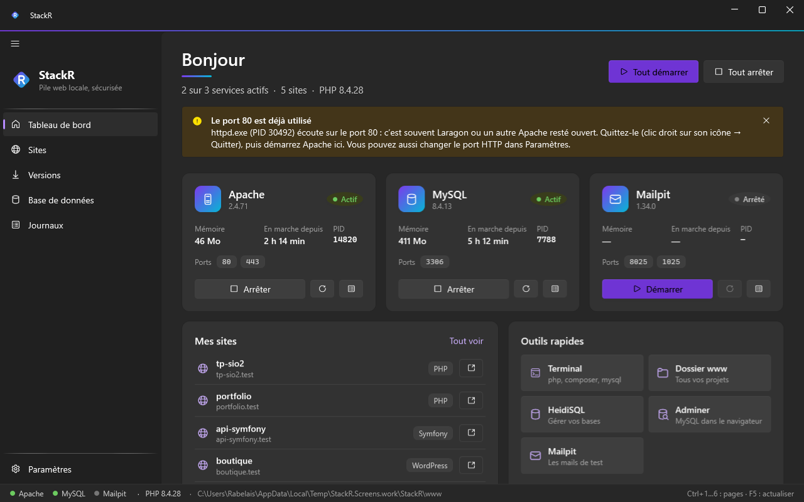
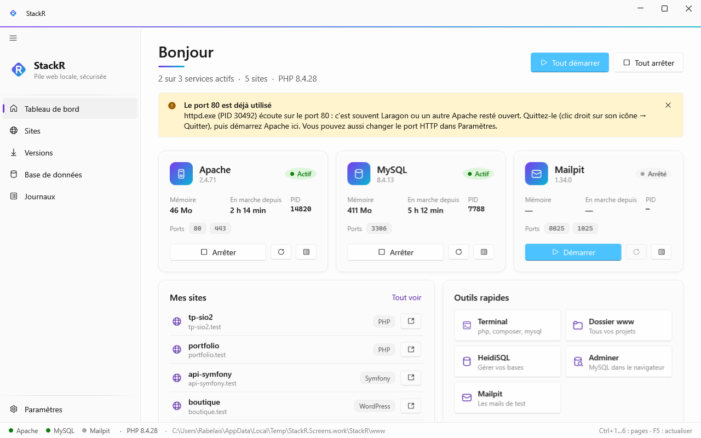
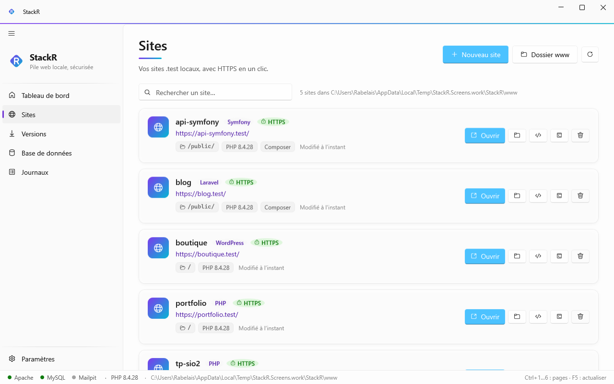
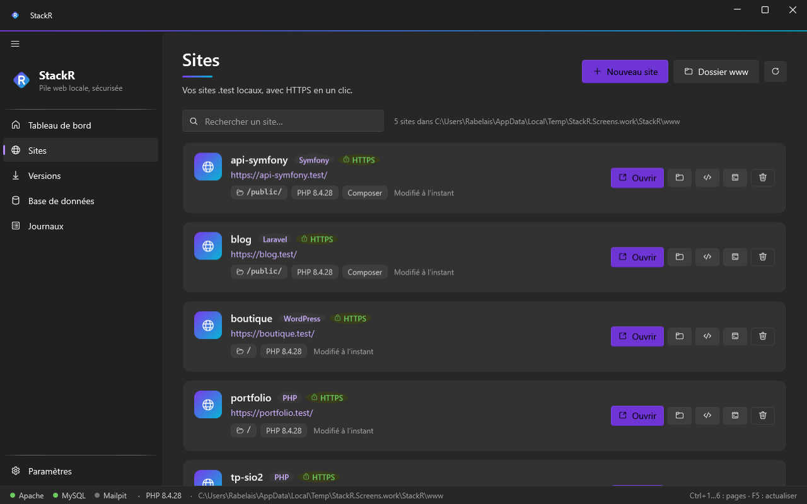
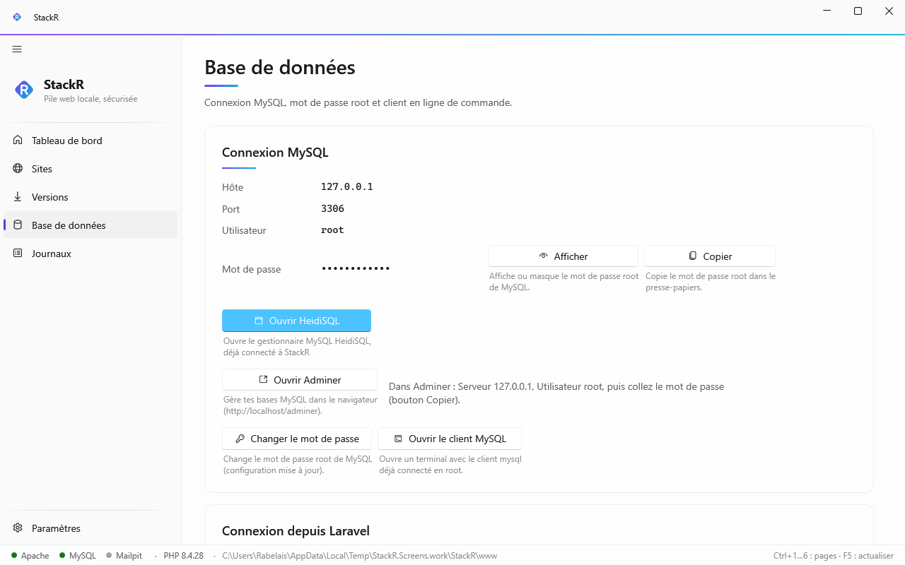
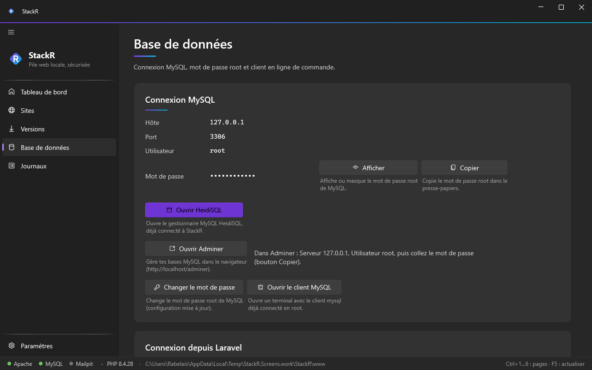

# StackR

Environnement de développement web local pour Windows, **sécurisé par défaut** :
Apache, PHP, MySQL, Mailpit, Node.js et Composer, avec sites `.test` en HTTPS
automatiques. Une alternative moderne à Laragon et XAMPP.

[](https://github.com/Ga3TH/StackR/actions/workflows/ci.yml)
[](LICENSE)




| Clair | Sombre |
|---|---|
|  |  |
|  |  |
|  |  |

## Fonctionnalités

- **Versions stables uniquement** : Apache 2.4.71, PHP 8.4.28 et 8.3.37, MySQL 8.4.13, Mailpit 1.34.0, Node.js 22 / 24, Composer 2.11.3, Adminer 6.3.1, HeidiSQL 12.22 (le catalogue évolue via `manifest/components.json`). Téléchargement depuis les sources officielles, **empreinte SHA-256 vérifiée** avant extraction.
- **Démarrage en un clic** de tous les services, avec état en temps réel et détection des ports occupés.
- **Sites automatiques** : chaque dossier de `www` devient `https://<nom>.test` (racine `public\` détectée).
- **HTTPS local** grâce à une autorité de certification propre à la machine, limitée à `.test` et `localhost`.
- **Changement de version PHP** en un clic.
- **Interface graphique MySQL** : **HeidiSQL** (client Windows natif, déjà connecté à StackR en un clic) et Adminer sont installés. Adminer est installé avec StackR, ouvert en un clic depuis la page Base de données (`http://localhost/adminer`, accessible uniquement depuis votre machine) : serveur `127.0.0.1`, utilisateur `root`, mot de passe copiable.
- **Commandes dans le terminal** : `php`, `mysql`, `composer`, `node` et `stackr`.
- **Zone de notification**, démarrage avec Windows (optionnel), mode sombre (interrupteur dans les Paramètres, ou suivi de Windows), interface en français (anglais disponible).
- **Aucun droit administrateur** pour l'usage courant (une seule demande UAC pour le fichier hosts).

## Prérequis

- Windows 10 (22H2) ou Windows 11, 64 bits.
- Visual C++ Redistributable 2015-2022 x64 (requis par Apache et PHP) : StackR le détecte et propose l'installation depuis le lien officiel Microsoft.
- Environ 1 Go d'espace disque et une connexion Internet pour le téléchargement des composants.

## Installation pas à pas

### A. Depuis une Release (recommandé)

1. Ouvrez la page [dernière Release](https://github.com/Ga3TH/StackR/releases/latest) et téléchargez **`StackR-Setup-<version>.exe`** (ou l'archive portable `StackR-<version>-win-x64.zip`).
2. Double-cliquez sur le fichier (**l'installeur inclut tout, ~400 Mo** : Apache, PHP, MySQL, Mailpit, Composer, Adminer et HeidiSQL s'installent sans connexion Internet).
   Si Windows affiche **« Windows a protégé votre ordinateur »** (SmartScreen), c'est normal : l'installeur n'est pas signé numériquement. Cliquez sur **Informations complémentaires**, puis **Exécuter quand même**.
3. L'assistant installe StackR pour votre utilisateur dans `%LOCALAPPDATA%\Programs\StackR`, sans droits administrateur. Cochez « Créer un raccourci sur le Bureau » si vous le souhaitez.
4. Terminez l'assistant et lancez StackR.

### B. Depuis les sources

1. Installez le SDK .NET 10 et Git (puis ouvrez un **nouveau** terminal pour qu'ils soient dans le PATH) :
   ```powershell
   winget install Microsoft.DotNet.SDK.10
   winget install Git.Git
   ```
   Vérifiez avec `dotnet --version` (10.x) et `git --version`.
2. Clonez le dépôt et construisez :
   ```powershell
   git clone https://github.com/Ga3TH/StackR.git
   cd StackR
   .\build.ps1
   ```
   `build.ps1` exécute les tests puis publie `StackR.App.exe` et `stackr.exe` côte à côte dans `publish\StackR\` (`.\build.ps1 -SkipTests` pour aller plus vite). Si [Inno Setup 6](https://jrsoftware.org/isinfo.php) est installé, l'installeur `publish\StackR-Setup.exe` est aussi généré.

   Si PowerShell refuse le script (« l'exécution de scripts est désactivée sur ce système »), autorisez les scripts locaux pour votre utilisateur, une fois pour toutes :
   ```powershell
   Set-ExecutionPolicy -Scope CurrentUser RemoteSigned
   ```
   ou lancez-le ponctuellement sans rien changer :
   ```powershell
   powershell -ExecutionPolicy Bypass -File .\build.ps1
   ```
3. Lancez `publish\StackR\StackR.App.exe`.

> Gardez `StackR.App.exe` et `stackr.exe` dans le même dossier : l'application relance `stackr.exe` en mode élevé pour synchroniser le fichier hosts.

## Premier lancement

L'assistant vous guide :

1. **Dossier d'installation** : `C:\StackR` par défaut (modifiable ; hors de `Program Files`, donc sans admin).
2. **Choix des composants** : versions stables recommandées préselectionnées (Apache, PHP, MySQL, Mailpit, Node.js, Composer).
3. **Téléchargement vérifié** : chaque archive est contrôlée par SHA-256 avant extraction. Le mot de passe root de MySQL est généré aléatoirement.
4. **Autorité de certification HTTPS** : Windows demande de confirmer l'ajout de la CA au magasin de l'utilisateur. Acceptez.
5. **PATH** : `php`, `mysql`, `composer`, `node` et `stackr` sont ajoutés à votre PATH utilisateur (ouvrez un nouveau terminal ensuite).
6. **Fin** : cliquez sur **Tout démarrer** dans le Tableau de bord. Créez un dossier dans `www`, il devient `https://<dossier>.test`.

## Interface

- **Tableau de bord** : cartes des services, tout démarrer/arrêter, PHP actif, raccourcis.
- **Sites** : liste des `.test`, ouverture, dossier / VS Code, « Nouveau site » (vide ou Laravel via Composer).
- **Versions** : catalogue stable, installation avec progression, activation, désinstallation.
- **Base de données** : hôte, port, utilisateur, mot de passe root masqué (afficher/copier/changer), boutons « Ouvrir HeidiSQL » (principal) et « Ouvrir Adminer », client MySQL en terminal.
- **Journaux** : Apache, PHP, MySQL, Mailpit en direct.
- **Paramètres** : dossiers, démarrage avec Windows, démarrage auto des services, mode sombre, langue, confiance envers la CA.

Fermer la fenêtre la réduit dans la zone de notification.

## StackR SQL

StackR SQL est un gestionnaire MySQL web, clair/sombre, livré avec StackR (`web\stackr-sql\`, PHP sans
dépendance externe). Apache le sert sur **http://localhost/sql** (ou `http://localhost:<port>/sql`) ;
`http://localhost/sql/?db=<nom>` ouvre directement une base. Accès limité à la machine locale
(`Require local`), connexion MySQL vers 127.0.0.1 uniquement, identifiants gardés dans la session PHP,
jeton CSRF sur chaque requête, en-têtes CSP stricts. Fonctions : bases (taille, création, suppression
confirmée), tables (nombre de lignes, pagination, tri, structure et index), console SQL
(Ctrl+Entrée, durée, lignes affectées) et export d'une table en SQL ou CSV.

## Mises à jour

StackR cherche une nouvelle version sur GitHub (API publique, sans compte) au lancement puis toutes les 6 heures ; l'option se désactive dans Paramètres (« Rechercher les mises à jour automatiquement »), et « Rechercher maintenant » interroge tout de suite.

Quand une version plus récente existe, un bandeau « Mise à jour disponible » apparaît en haut de la fenêtre (Nouveautés = notes de version ; × = masquer pour cette version).

- **Copie installée** (installateur) : « Mettre à jour » télécharge l'installateur de la release (HTTPS, SHA-256 de GitHub vérifié, jamais exécuté s'il diffère), ferme StackR, l'installe en silencieux puis relance StackR. Les services restent actifs.
- **Copie portable** : le bouton ouvre la page de la release ; remplacez le dossier à la main.
- Une release sans empreinte SHA-256 publiée n'est pas installable depuis l'application : elle propose « Voir la release ».

## Migration depuis Laragon

StackR ne touche pas à votre installation Laragon.

1. **Exportez vos bases** pendant que le MySQL de Laragon tourne encore. Listez-les, puis exportez **vos** bases (pas les bases système `mysql`, `sys`, `information_schema`, `performance_schema`) :
   ```powershell
   C:\laragon\bin\mysql\<version>\bin\mysql.exe -u root -e "SHOW DATABASES"
   C:\laragon\bin\mysql\<version>\bin\mysqldump.exe -u root --databases base1 base2 --routines --events --result-file=sauvegarde.sql
   ```
   N'utilisez pas `--all-databases` : il exporte aussi la base système `mysql`, dont l'import remplacerait le mot de passe root de StackR. `--result-file` évite la redirection `>` de PowerShell, qui écrit le fichier en UTF-16 illisible par `mysql`.
2. **Arrêtez Laragon** (quittez-le complètement) pour libérer les ports 80, 443 et 3306.
3. **Pointez `www` vers vos projets** : dans StackR, *Paramètres → Dossier www* → `C:\laragon\www` (vos projets sont réutilisés sur place), puis redémarrez StackR ; ou copiez-les dans `C:\StackR\www`.
4. **Démarrez MySQL dans StackR, puis importez** (le mot de passe root est dans la page *Base de données*, ou `stackr db password`). PowerShell ne connaît pas la redirection `<` : passez par `cmd` :
   ```powershell
   cmd /c "mysql -u root -p < sauvegarde.sql"
   ```
5. **Mettez à jour vos fichiers `.env`** : `DB_HOST=127.0.0.1`, `DB_PORT=3306`, `DB_USERNAME=root` et `DB_PASSWORD=` avec le **nouveau mot de passe root** affiché dans la page *Base de données* (Laragon utilisait un mot de passe vide ; StackR en impose un). Créez de préférence un utilisateur dédié par projet.
6. Vérifiez la version de PHP dans la page *Versions* (par exemple 8.3 comme sous Laragon).

## Utilisation en ligne de commande

```text
stackr status                          état des services, PHP actif, dossier www
stackr start [service]                 applique la configuration puis démarre tout (services installés), ou apache | mysql | mailpit
stackr stop [service]                  arrête tout, ou un service
stackr restart [service]               arrête puis redémarre
stackr sites                           liste les sites .test
stackr versions [composant]            versions du catalogue : installée, active, recommandée
stackr install <composant> [version]   ex. stackr install php 8.4.28 (sans version : la recommandée)
stackr use <composant> <version>       active une version installée, ex. stackr use php 8.3.37
stackr uninstall <composant> <version> supprime une version installée (ni active, ni service en marche)
stackr db password [--copy]            affiche (ou copie) le mot de passe root MySQL
stackr ca trust                        approuve la CA locale (confirmation Windows)
```

Composants : `apache`, `php`, `mysql`, `mailpit`, `node`, `composer`. `stackr start` met aussi à jour le fichier hosts : si de nouveaux sites `.test` sont apparus, Windows demande une confirmation (UAC). `stackr hosts sync --names … | --clear` est la commande que StackR relance lui-même en administrateur pour cela ; vous n'avez pas à l'utiliser.

Codes de sortie : 0 succès, 1 erreur, 2 arguments invalides, 5 droits administrateur requis.

## Sécurité

Voir aussi [SECURITY.md](SECURITY.md).

- Tous les services n'écoutent que sur `127.0.0.1`.
- Binaires issus des sources officielles, SHA-256 vérifié avant extraction, protection zip slip.
- Fichier hosts : bloc `# >>> StackR` / `# <<< StackR`, noms validés `^[a-z0-9-]+\.test$`, écriture par `stackr.exe hosts sync` élevé uniquement.
- CA locale ECDSA P-256 à contrainte de nom (`.test`, `localhost`), clé privée chiffrée DPAPI.
- Mot de passe root MySQL aléatoire (24 caractères), chiffré DPAPI ; `bind-address=127.0.0.1`, `mysqlx=OFF`.
- Apache : `ServerTokens Prod`, `ServerSignature Off`, `TraceEnable Off` ; PHP : `expose_php=Off`, `allow_url_include=Off`.

## Désinstallation propre

StackR ne modifie que des éléments de votre profil, listés ci-dessous. Sauvegardez d'abord vos bases (`mysqldump`) et vos projets de `www`.

1. **Services et démarrage automatique** : dans StackR, cliquez sur **Tout arrêter** (ou `stackr stop`), désactivez *Démarrer avec Windows* (*Paramètres*), puis quittez StackR depuis la zone de notification. Si l'application n'est plus disponible, supprimez la valeur `StackR` de la clé `HKEY_CURRENT_USER\Software\Microsoft\Windows\CurrentVersion\Run` (`regedit`).
2. **Application** : désinstallez StackR (*Paramètres Windows → Applications → StackR*), ou supprimez le dossier `%LOCALAPPDATA%\Programs\StackR` si vous l'avez construit depuis les sources.
3. **PATH** : *Paramètres Windows → Système → Informations système → Paramètres avancés du système → Variables d'environnement*, puis dans les variables **utilisateur**, modifiez `Path` et supprimez les entrées `<racine>\bin\shims` (`C:\StackR\bin\shims` par défaut) et le dossier de l'application (`%LOCALAPPDATA%\Programs\StackR`).
4. **CA** : `Win + R` → `certmgr.msc` → *Autorités de certification racines de confiance → Certificats*. Supprimez le ou les certificats nommés **`StackR Local CA (<NOM-DU-PC>)`** (par exemple `StackR Local CA (BUREAU-PC)`, le nom de votre ordinateur entre parenthèses). Ne touchez à aucun autre certificat.
5. **Bloc hosts** : ouvrez le Bloc-notes **en administrateur**, puis `C:\Windows\System32\drivers\etc\hosts`, supprimez les lignes de `# >>> StackR` à `# <<< StackR` incluses, enregistrez.
6. **Données** : supprimez le dossier racine (`C:\StackR` par défaut : composants, configurations, bases MySQL, certificats, journaux, et `www` s'il n'a pas été déplacé) et le dossier des paramètres `%LOCALAPPDATA%\StackR` (`stackr.json`).

## FAQ

**Les ports 80/443/3306 sont occupés.** Laragon (ou XAMPP, IIS, Skype…) tourne probablement encore. Quittez Laragon complètement ; StackR indique le processus qui occupe chaque port.

**SmartScreen bloque l'installeur.** Il n'est pas signé numériquement : *Informations complémentaires → Exécuter quand même*. Vous pouvez vérifier l'empreinte du fichier publiée avec la Release.

**Mon antivirus signale un fichier.** Les exécutables non signés déclenchent parfois des faux positifs. Ajoutez une exception pour le dossier d'installation, ou construisez depuis les sources (installation B).

**Le navigateur affiche un avertissement de certificat.** La CA n'est pas approuvée : ouvrez *Paramètres* dans StackR et cliquez sur **Faire confiance** (confirmez la boîte de dialogue Windows), puis redémarrez le navigateur.

**Un site `.test` ne s'ouvre pas.** Vérifiez que la demande UAC du fichier hosts a été acceptée : relancez `stackr start` (ou **Tout démarrer**) et acceptez la confirmation Windows.

**`.\build.ps1` est refusé par PowerShell.** Voir l'installation B : `Set-ExecutionPolicy -Scope CurrentUser RemoteSigned`, ou `powershell -ExecutionPolicy Bypass -File .\build.ps1`.

## Contribuer

```powershell
dotnet build -c Release
dotnet test -c Release --filter "Category!=Integration"
```

- `tools\update-manifest.ps1` : script mainteneur qui récupère les dernières versions stables et leurs SHA-256 pour `manifest/components.json`.
- Structure : `src/StackR.Core` (logique), `src/StackR.App` (WPF), `src/StackR.Cli` (`stackr`), `tests/StackR.Core.Tests` (xUnit).
- Les avertissements sont traités comme des erreurs. Aucun binaire tiers n'est versionné.

## Licence

[MIT](LICENSE) © 2026 Ga3TH
